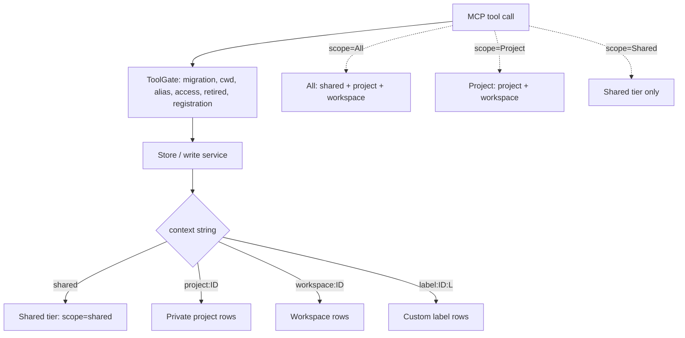
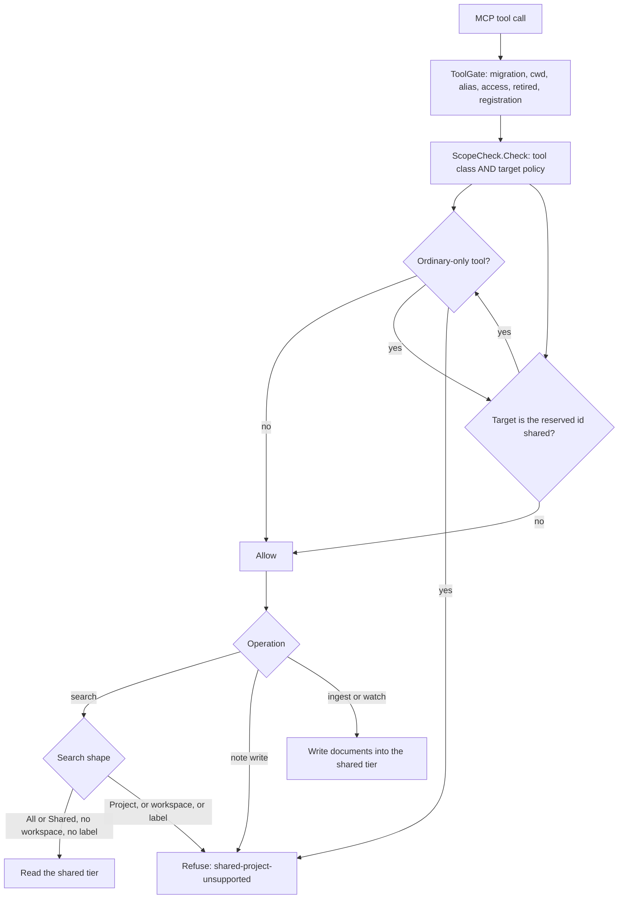

# Research: the scope-check model in ai-raccoon PR #906

**Date:** 2026-10-21
**Question:** In ai-raccoon PR #906 (`task/air-shared-project-document-watch-support`, head `3849135e`),
how is the scope check actually executed, which searches and writes are allowed for the
`All`/`Shared`/`Project` scopes, what changed against `origin/main` (v1.61.1), and is the
resulting model correct?

**Subject:** PR #906, branch head `3849135e` ("refactor: route code search by query scope");
base `origin/main` before the merge = `bccdab70` (VERSION 1.61.1). The PR was merged while this
review ran, as `3b9fbc00` ("feat: shared project document watches (#906)", 2026-10-21 20:34);
`git diff 3849135e 3b9fbc00 -- src/ docs/` is empty, so every measurement below describes what
is now on `main`.
**Stance:** read-only review. No file on the PR branch was left modified. Two temporary probe
files were added to throwaway worktrees, run, and deleted (F3, F6).
**Machine:** Apple M4, 24 GB, macOS Darwin 27.0.0 arm64, .NET SDK 10.0.402.

## Findings

### F1 — The scope check is the last of six gates in the MCP tool path, not the first [READ]

`ToolGate.RequireAsync` runs, in order: the model-migration refusal, cwd resolution of a blank
id, alias folding, access-mode enforcement, retired-id refusal, registration — and only then the
scope check. Two consequences follow. The scope refusal is the outermost of the two refusals,
not the innermost: a caller that fails the access or registration check is turned away before
it can learn that the id is the reserved target. And the scope check is the only check whose
answer depends on the *tool*, not just on the id.

**Evidence:** `src/AiRaccoon/Tools/ToolGate.cs:44-64` at head `3849135e`.

### F2 — The scope decision is the composition of two independent questions, and only one combination is refused [READ]

`ScopeCheck.Check` returns `!RequiresOrdinaryProject(toolName) || !IsReserved(canonicalProjectId)`.
A tool is refused only when it is an *ordinary-only* tool **and** the target is the reserved
`shared` id. The two axes are a tool classification (host-side, `IToolNameScope`) and a target
policy (Core-side, `ISharedProjectScope`); the host's `ScopeCheck` is the only place they meet.
The tool list is seven exact names plus two ordinal prefix families:
`memory_write`, `memory_share`, `memory_share_extract`, `memory_sweep`, `memory_set_ttl`,
`code_get`, `memory_delete_context`; `memory_workspace_*`, `memory_promotion_*`.

**Evidence:** `src/AiRaccoon/Tools/ScopeCheck.cs:9-10`, `src/AiRaccoon/Tools/ToolNameScope.cs:7-11`,
`src/AiRaccoon.Core/Projects/SharedProjectScope.cs:26-31`.

### F3 — Thirteen of the thirty MCP tools are refused on the reserved target; seventeen are allowed [MEASURED]

| refused on `shared` (13) | allowed on `shared` (17) |
|---|---|
| `code_get` | `memory_delete` |
| `memory_delete_context` | `memory_embed_pending` |
| `memory_promotion_discard` | `memory_get` |
| `memory_promotion_list` | `memory_ingest_directory` |
| `memory_set_ttl` | `memory_ingest_file` |
| `memory_share` | `memory_list` |
| `memory_share_extract` | `memory_performance` |
| `memory_sweep` | `memory_record_followthrough` |
| `memory_workspace_begin` | `memory_record_grade` |
| `memory_workspace_consolidate` | `memory_search` |
| `memory_workspace_discard` | `memory_stats` |
| `memory_workspace_status` | `memory_sync` |
| `memory_write` | `memory_watch_add` / `memory_watch_remove` / `memory_watch_status` |
| | `project_id_get` / `project_id_token_get` |

Every one of the thirty is allowed on an ordinary project. The list is the *whole* set of MCP
tool names in the assembly, taken from the generated inventory, so nothing is hidden by a
narrower enumeration. Two of the seventeen are allowed *vacuously*: `project_id_get` and
`project_id_token_get` never call the gate's `RequireAsync` at all — they call only the
migration check — so the scope check never runs for them, and `memory_performance` skips it
for the server's own metrics sentinel. Twenty-eight of the thirty tools therefore reach the
scope check, and the other two are unaffected by it either way.

**Evidence:** a console probe (`/tmp/scope-probe`, `dotnet run -c Debug`) that references the
branch's `AiRaccoon.Core.csproj` and `AiRaccoon.csproj` directly, constructs the production
`new ScopeCheck(new ToolNameScope(), new SharedProjectScope())`, and prints
`Check("shared", name)` / `Check("acme", name)` for every name in
`McpToolInventory.Names()`. A second probe printed `McpToolInventory.Names().Count` = 30 and
`.Distinct().Count()` = 30 (no name is listed twice). The gate call sites are the 28
`gate.RequireAsync(..., TnXxx, ...)` calls across `src/AiRaccoon/Tools/*.cs`; the two
`ProjectTools` methods call `gate.RequireBankAvailableAsync` only, at
`src/AiRaccoon/Tools/ProjectTools.cs:34` and `:52`, and `memory_performance` takes the
`RequireBankAvailableAsync` branch at `src/AiRaccoon/Tools/PerformanceTools.cs:32`.

### F4 — Searches: the reserved target accepts `All` and `Shared` only, with no workspace and no context label [MEASURED]

| target | scope | workspace | label | decision |
|---|---|---|---|---|
| `shared` | `All` | – | – | **allow** → contexts `[shared]` |
| `shared` | `All` | `scratch` | – | refuse |
| `shared` | `All` | – | `docs` | refuse |
| `shared` | `Shared` | – | – | **allow** → contexts `[shared]` |
| `shared` | `Shared` | `scratch` | – | refuse |
| `shared` | `Shared` | – | `docs` | refuse |
| `shared` | `Project` | – | – | refuse |
| `shared` | `Project` | `scratch` | – | refuse |
| `shared` | `Project` | – | `docs` | refuse |
| `acme` | `All` | – | – | allow → `[shared, project:acme]` |
| `acme` | `All` | `scratch` | – | allow → `[shared, project:acme, workspace:scratch]` |
| `acme` | `All` | – | `docs` | allow → `[shared, label:acme:docs]` |
| `acme` | `Shared` | – | – | allow → `[shared]` |
| `acme` | `Shared` | `scratch` | – | allow → `[shared]` |
| `acme` | `Shared` | – | `docs` | allow → `[shared]` |
| `acme` | `Project` | – | – | allow → `[project:acme]` |
| `acme` | `Project` | `scratch` | – | allow → `[project:acme, workspace:scratch]` |
| `acme` | `Project` | – | `docs` | allow → `[label:acme:docs]` |

An ordinary project is never refused. For the reserved target, `All` and `Shared` are
indistinguishable: both read the single `shared` context, so `All` carries no extra reach
there.

**Evidence:** two probes on the same machine. (a) `/tmp/scope-probe` prints
`CanExecuteInSharedScope(query)` and the `EnsureCanExecuteInSharedScope(query)` outcome for
every row above. (b) a temporary xunit probe added to the branch worktree's test project calls
`AiRaccoon.Infrastructure.Sqlite.SearchContexts.For(query, scope, labels)` by reflection and
writes the context list to `/tmp/after-matrix.tsv`; the file was deleted with the probe. The
refusal text is `shared-project-unsupported: search shared with scope all or shared, without a
workspace or label.`

### F5 — Writes: every note write to the reserved target is refused, whatever context or workspace it names [MEASURED]

| target | context | workspace | derived `MemoryWriteScope` | decision |
|---|---|---|---|---|
| `shared` | – | – | `Project` | refuse |
| `shared` | `shared` | – | `Shared` | refuse |
| `shared` | `shared` | `scratch` | `Workspace` | refuse |
| `shared` | `project:acme` | – | `Project` | refuse |
| `acme` | – | – | `Project` | allow |
| `acme` | `shared` | – | `Shared` | allow → promotion request |
| `acme` | `shared` | `scratch` | `Workspace` | allow → plain project write |
| `acme` | `project:acme` | – | `Project` | allow |

The write decision does not depend on the context at all: for the reserved target it is a flat
"no". For an ordinary project a `context='shared'` request still asks for promotion and the
workspace still wins over it, exactly as before the change.

**Evidence:** `/tmp/scope-probe` prints `MemoryWriteRequest.Scope`,
`CanExecuteInSharedScope(request)` and the `EnsureCanExecuteInSharedScope(request)` outcome for
every row above. The derived scope follows `src/AiRaccoon.Core/Memory/MemoryWriteRequest.cs:16-19`
(a non-blank workspace selects `Workspace`, otherwise an exact `shared` context selects `Shared`,
everything else `Project`).

### F6 — Before and after: the reserved target is a new *kind* of project id, and `scope` keeps its old meaning for ordinary projects [MEASURED]

On `origin/main` (v1.61.1) `shared` was an ordinary project id with no special meaning; on the
branch it is a reserved document target. The context list a query reads changed only for the
reserved id:

| target | scope | before (`origin/main`) | after (PR head) |
|---|---|---|---|
| `acme` | `All` | `[shared, project:acme]` | `[shared, project:acme]` |
| `acme` | `Project` | `[project:acme]` | `[project:acme]` |
| `acme` | `Shared` | `[shared]` | `[shared]` |
| `shared` | `All` | `[shared, project:shared]` | `[shared]` |
| `shared` | `Project` | `[project:shared]` | **refuse** |
| `shared` | `Shared` | `[shared]` | `[shared]` |
| `shared` | `All` + workspace | `[shared, project:shared, workspace:scratch]` | **refuse** |
| `shared` | `Project` + label | `[label:shared:docs]` | **refuse** |

The rows for an ordinary project are byte-identical before and after: the `scope` axis keeps
its meaning, and the reserved target does not change it. Before, `project:shared` and the
`shared` tier were two different things that happened to share a name; after, the id `shared`
names one thing — the shared tier — and the project-shaped context behind it is gone.

**Evidence:** the same reflection probe run twice — once against a fresh worktree of
`origin/main` (`bccdab70`), writing `/tmp/before-matrix.tsv`, and once against the branch head,
writing `/tmp/after-matrix.tsv`; both temporary probe files were deleted after the run.

### F7 — The reserved id is case-sensitive, and its rows land in `scope='shared', project_id='shared'` [MEASURED]

`IsReserved` accepts the exact ordinal `shared` only: `Shared`, `SHARED`, `" shared"` and
`shared-documents` are ordinary project ids, and their rows go to `project:<id>`. The reserved
target's documents land in the existing shared tier with the project column set to `shared` —
the same tier a promotion lands in, which is why one context string serves both.

**Evidence:** `/tmp/scope-probe` prints `IsReserved` and `ContextFor` for
`shared`, `Shared`, `SHARED`, `" shared"`, `shared-documents`, `acme`; the only reserved id is
`shared`, whose `ContextFor` is `shared` (the others are `project:<id>`). The bucket mapping is
`src/AiRaccoon.Infrastructure/Sqlite/EntryBucket.cs:10-16` (context `shared` → scope `shared`,
project column = the caller's id), and `src/AiRaccoon.Infrastructure/Ingestion/FileIngestor.cs:402-414`
resolves the reserved target's ingest context to that same string.

### F8 — The tool list is hand-maintained, default-allows, and is not cross-checked against the generated tool inventory [READ]

`ToolNameScope.RequiresOrdinaryProject` is a hand-written list, and every name not on it is
allowed on the reserved target. The test that pins it uses hand-written `InlineData` — including
the cases `"unknown"`, `"memory_write_extra"` and `"Memory_write"`, all asserted *allowed* — so
default-allow is deliberate. But nothing compares the list against the assembly's generated
`McpToolInventory.Names()`, which is exactly the mechanism that would notice a new tool.
The failure mode is one-directional and silent: a new write-shaped tool added to the MCP surface
is allowed on the reserved target until somebody remembers the list.

**Evidence:** `src/AiRaccoon/Tools/ToolNameScope.cs:7-11`; the pinning test
`tests/AiRaccoon.Tests/Unit/Mcp/ScopeCheckTests.cs` (hand-written `InlineData` rows; no
reference to `McpToolInventory` anywhere in the test project except
`tests/AiRaccoon.Tests/Unit/Mcp/McpToolInventoryTests.cs:22`, which compares the inventory with
`RegisteredTools.Names()` and says nothing about the scope list).

### F9 — ADR-0137 still describes a method the head commit removed [READ]

ADR-0137's Consequences section says the scope contract exposes
"`CanSearchCode(SearchQuery)` separately checks code routing, so an ordinary all-scope search
keeps its code leg". The head commit `3849135e` ("refactor: route code search by query scope")
removed `CanSearchCode` from `ISharedProjectScope`; the dispatcher now reads
`searchQuery.Scope is SearchScope.Shared` directly. ADR-0137's own sentence is therefore false
as written — in the merged `main` too — and the PR's own work record repeats it. A new
ADR-0138, authored by another session on a separate branch (`docs/search-scope-routing`) and
not part of the merge, states "Amends: ADR-0137's `CanSearchCode(SearchQuery)` consequence", so
the drift is known and a correction is in flight; ADR-0137 itself is not amended.

**Evidence:** `docs/adr/0137-shared-target-for-document-watches.md:59`;
`docs/work/2026-10-21-air-shared-project-document-watch-support.md:127`;
`src/AiRaccoon.Core/Projects/ISharedProjectScope.cs` (no `CanSearchCode` at head);
`src/AiRaccoon.Core/Memory/SearchDispatcher.cs:32-35`;
`docs/adr/0138-search-scope-routes-memory-and-code.md:9` (branch `docs/search-scope-routing`,
not merged).

### F10 — The last commit changed the code leg's route but not the reserved target's behaviour [MEASURED]

Before `3849135e`, the dispatcher emptied the code section for the reserved target
(`!CanSearchCode(query)` — false for any reserved id). After it, the code section is emptied
only for `scope=shared`, so an `All` search on the reserved target now *runs* the project-code
leg. The two are equivalent in practice, because shared ingestion skips code files and a
pre-existing `code_entries` row under `shared` blocks activation of the target outright — so
the leg can only ever return empty. The change moves the invariant from the search layer to the
ingestion layer.

**Evidence:** `git show bd8c7001 -- src/` versus `git show 3849135e -- src/`; the code leg
guard is `src/AiRaccoon.Core/Memory/SearchDispatcher.cs:32-35`; the ingestion skip is
`src/AiRaccoon.Infrastructure/Ingestion/FileIngestor.cs:92-95` and `:204`; the activation block
is `src/AiRaccoon.Infrastructure/Sqlite/SharedProjectStorage.cs:35-47`
(the `code_entries` check is line 38).
(`EXISTS(SELECT 1 FROM code_entries WHERE project_id = @projectId)`).

### F11 — The commit before it added an escape hatch, and the head commit removed it [READ]

`bd8c7001` ("fix: align shared scope permission with search scope") made the search check
`query.Scope is All or Shared && (...)`, which is false for an ordinary project with
`scope=project` — so the throwing extension had to carry a special case
(`isProjectOnlySearch = query.Scope is SearchScope.Project && !scope.IsReserved(projectId)`) to
let ordinary project-only searches through. The head commit reverted to the simpler
`!IsReserved(projectId) || (scope != Project && no workspace && no label)` form, and the escape
hatch with it. The simpler form is the one that shipped.

**Evidence:** `git show bd8c7001 -- src/AiRaccoon.Core/Projects/` (the escape hatch in
`SharedProjectScopeExtensions.EnsureCanExecuteInSharedScope`); `git show 3849135e -- src/` (its
removal); the shipped form is `src/AiRaccoon.Core/Projects/SharedProjectScope.cs:26-28`.

### F12 — `memory_delete` is the one destructive tool allowed on the reserved target, and on that target it can only ever remove a single chunk [MEASURED]

`memory_delete` is not in the ordinary-only list, so it is allowed on `shared`. Its scope is
right — the delete predicate is `project_id = @projectId`, so it never touches another
project's rows. What the operation *does* on the reserved target, however, is neither
documented nor coherent:

- The reserved target's `project_id='shared'` rows exist only as mirrored documents: a note
  write to the target is refused, and a promotion carries the *promoting* project's id. Every
  such row therefore has `source_file = path` (FileIngestor sets it for its own group), and the
  delete predicate's whole-write branch is gated on `(source_file IS NULL OR source_file <> path)`.
  The consequence is that `memory_delete` on the reserved target removes **only the chunk whose
  hash was named** — the document's other chunks survive, and the document stays partially
  indexed. Measured on a four-chunk document ingested into the reserved target:
  `rows_before=4 rows_after=3 deleted=1`, with the named hash gone and the other three chunks
  still indexed under the same source file.
- It does not advance the watch fingerprint. Only `DeleteSourcePathAsync` cascades the
  `watch_files` delete; the entry delete touches `entries` and the sync tombstones alone.
- The watch digest therefore hash-skips on the unchanged fingerprint, so the content is *not*
  restored: the document stays partially indexed and the watch keeps reporting the file as
  current. The only recovery is an explicit re-ingest or a change to the file.

Neither ADR-0137's refusal list ("project-only search, custom contexts, workspace
search/writes, note writes and promotion/sweep operations") nor the operator reference mentions
`memory_delete` either way.

**Evidence:** the probe in F3 prints `memory_delete` as allowed on `shared`;
a temporary integration probe (added, run and deleted) ingested a four-chunk document into the
reserved target and called `DeleteAsync("shared", <one chunk's hash>)`: `rows_before=4
rows_after=3 deleted=1 named_hash_still_present=False source_file_set=<the file path>`;
`src/AiRaccoon.Infrastructure/Sqlite/MemorySql.cs:190-205` (the predicate and the
`source_file` guard, with the comment that FileIngestor always sets `source_file = path`);
`src/AiRaccoon.Infrastructure/Sqlite/Memory/SqliteMemoryStore.Deletes.cs:118-161` (the entry
delete touches no fingerprint) against `:79-110` (`DeleteSourcePathAsync`, which does);
`src/AiRaccoon.Infrastructure/Watch/WatchDigestExecutor.cs:135-141` (the hash-skip);
`docs/adr/0137-shared-target-for-document-watches.md` (the refusal list, which omits it);
`docs/reference/agent-memory-server.md:34-37` (the operator list, which omits it too — it names
"notes, promotion operations, TTL changes, sweeps, code retrieval and context deletion").

### F12a — The reserved target's content is owned by the watch and the file, so the honest ruling is to refuse the delete [INFERRED]

Reasoning from F12: the reserved target supports "document ingestion and watches" — its content
lifecycle is the file's, mirrored by the watch. A `memory_delete` there is not a content
operation with a defined meaning; it is a partial delete that leaves the watch claiming a
state the bank no longer holds, and nothing in the system reconciles the two (the digest
hash-skips, the reingest repair only walks rows that still exist, and the catch-up scan
hash-skips as well). Refusing it on the reserved target — the same refusal the other
ordinary-only operations get — leaves one coherent model: the target's content changes when
its file changes, and an operator who wants a document gone removes the watch or the file.
Keeping it allowed would mean documenting a half-delete whose recovery path is a manual
re-ingest.

**Evidence:** reasoning from F12 and the repair's own scope
(`src/AiRaccoon.Infrastructure/Ingestion/ReingestRepair.cs:52-66` — it selects groups from
*existing* rows, so a deleted document is not a candidate).

### F13 — The search-shape rule is enforced in three places and the write rule in two, all reading one contract [READ]

The search shape is checked in `SearchDispatcher.DispatchAsync`, in
`SqliteMemoryStore.SearchAsync` and again in `SearchContexts.For`; the write rule in
`MemoryWriteService.WriteAsync` and `SqliteMemoryStore.WriteAsync`; the workspace rule in
`WorkspaceService` and `SqliteWorkspaceStore`. Every one of them asks the same injected
`ISharedProjectScope`, and the store-level checks are what protect the CLI and the API from
callers that never pass through the tool gate.

**Evidence:** `src/AiRaccoon.Core/Memory/SearchDispatcher.cs:19`,
`src/AiRaccoon.Infrastructure/Sqlite/Memory/SqliteMemoryStore.cs:170` (search) and `:67`
(write), `src/AiRaccoon.Infrastructure/Sqlite/SearchContexts.cs:36`,
`src/AiRaccoon.Core/Memory/MemoryWriteService.cs:61`,
`src/AiRaccoon.Infrastructure/Workspace/WorkspaceService.cs:21,34,47,84`,
`src/AiRaccoon.Infrastructure/Sqlite/SqliteWorkspaceStore.cs:19`.

### F14 — The scope model is coherent, with one default-allow seam and one naming problem [INFERRED]

Reasoning from F1–F13: the model is *one* rule expressed twice, and both expressions agree with
the ADR and the operator reference. A reserved project id that names the shared tier, plus a
tool-class list of the operations a shared document target must not perform, is a defensible
design: it reuses the MCP shape ("every tool takes a projectId") instead of inventing a second
addressing mode, and it keeps `scope` meaning the same thing for every project. The cost is
that a *view* has to be dressed as a *project*, which is why six places learned about the
reserved id (alias map, fold plan, repair, cwd resolver, project directory, registration
guard) — the seam is wider than the feature.

Two weaknesses survive the review. The first is F8: the tool list default-allows and nothing
compares it with the tool surface, so the model's safety argument rests on a list nobody
derives. The second is naming: `ISharedProjectScope.CanExecuteInSharedScope` answers "is this
operation allowed for this target", not "can this execute in the shared scope" — an ordinary
project's `scope=project` search does not touch the shared scope at all, yet the method
returns `true` for it; and the `EnsureCanExecuteInSharedScope(string projectId, string operation)`
overload takes an `operation` that never reaches the decision, only the message.

**Evidence:** reasoning from F2, F4, F5, F8 and F13; the naming is visible at
`src/AiRaccoon.Core/Projects/ISharedProjectScope.cs:18-22` and
`src/AiRaccoon.Core/Projects/SharedProjectScopeExtensions.cs:29-35`.

### F15 — The branch's own scope and shared-project test surface is green at the head commit [MEASURED]

108 tests pass: the scope-check unit tests, the shared-project scope unit tests, the shared
project integration tests, and the tool-gate tests. The full fast and slow suites and the CI
workflows named in the PR's work record were not re-run here.

**Evidence:** `dotnet test tests/AiRaccoon.Tests/AiRaccoon.Tests.csproj --no-build -c Debug
--filter "FullyQualifiedName~SharedProject|FullyQualifiedName~ScopeCheck|FullyQualifiedName~ToolGate"`
on the branch worktree at `3849135e` (build clean first: `dotnet build -c Debug` → 8 projects,
0 errors, 0 warnings) — 108 total, 0 failed, 0 skipped, 3.4 s.

## Diagrams

### The scope check, before (`origin/main`, v1.61.1)

`shared` is an ordinary project id. There is no scope check in the tool gate, and the store
routes on the context string alone.



### The scope check, after (PR #906 head)

Two questions compose. The tool axis is a classification; the target axis is a policy. The
reserved target is a document target: it reads the shared tier and ingests documents, and it
performs no note, workspace, promotion, sweep, TTL, code-read or context-delete operation.



### The search matrix, before and after

`1` = allowed, `0` = refused.

```chart:matrix
title: search allow/deny, 1 = allowed
target/scope, all, shared, project
acme (any workspace/label), 1, 1, 1
shared, 1, 1, 0
shared + workspace, 0, 0, 0
shared + context label, 0, 0, 0
```

## Still open

- Whether `memory_delete` on the reserved target is intended. It is allowed, its scope is
  correct, and neither the ADR nor the operator reference mentions it (F12). A ruling would
  settle it; the alternative is to add it to the refusal list and to the reference's
  enumeration.
- Whether the tool list should be *derived* from the generated `McpToolInventory` rather than
  maintained by hand. A test that fails when the inventory grows and the list has not been
  revisited would close the seam in F8; whether the project wants that gate is an owner call.
- The two ADR sentences about `CanSearchCode` (F9) are being addressed by ADR-0138 on a branch
  that has not merged. Whether ADR-0137 is amended in place, or left standing with 0138's
  "Amends" line as the correction, is not settled.
- The PR merged as `3b9fbc00` while this review ran; every measurement here is against commit
  `3849135e`, whose `src/` and `docs/` tree is identical to the merge. The PR's own full fast
  and slow suites, the CI workflows and the retry-surface gate were not re-run here (F15 covers
  only the scope and shared-project surface). The PR's work record reports them green at an
  earlier head.
- Another session was editing the branch worktree's documentation throughout this review, and
  has since committed ADR-0138 on a separate branch. Nothing here says whether that follow-up
  changes any behaviour; it does not touch `src/`.
